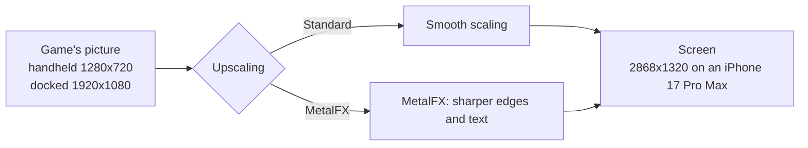
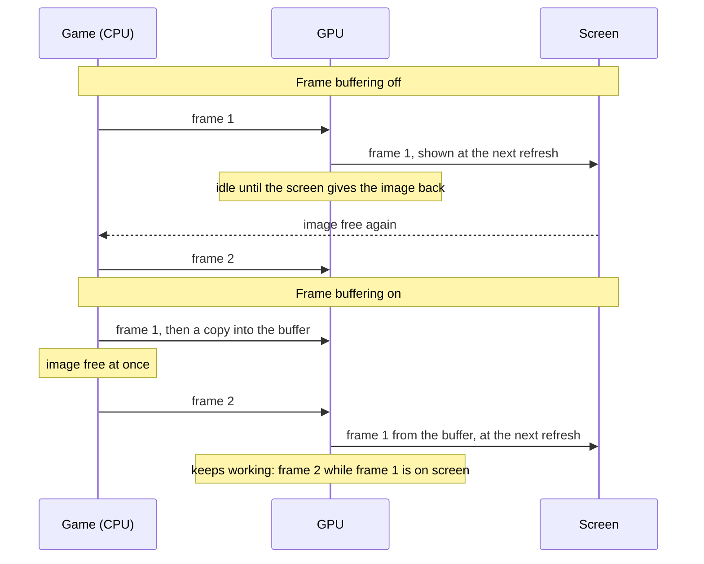
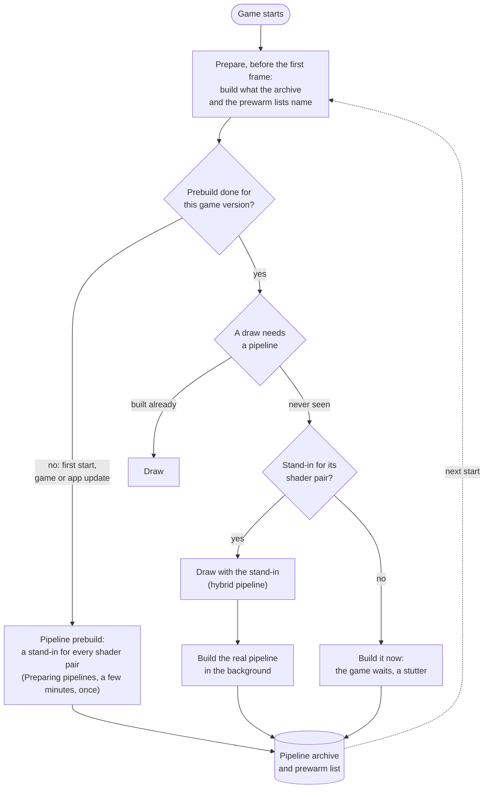
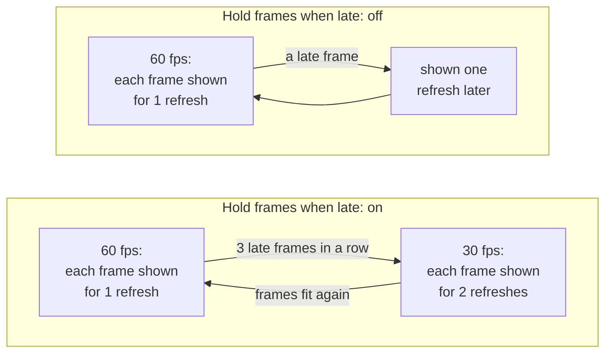

# Settings

The screen before the game starts shows the settings the game supports. A setting that only matters while another is on appears under it and disappears when that one is turned off. The game's name and version are at the top, with the version of the app itself under them (**LoR NX v0.0.0**; [Versioning](../CONTRIBUTING.md#versioning)). Tap **Play** to start; the app remembers your choices for the next start. All settings are on one scrollable screen, under **Game**, **Controls**, **Performance** and **Memory**. Tap a menu or move a slider there; no settings page needs opening. **Upscaling** is in **Game**, beside **Console mode**. A Mac app shows the same settings in a [window of its own](#the-mac-settings-window).

- [Tested defaults](#tested-defaults)
- [Game](#game): [Frame rate](#frame-rate), [Render scale](#render-scale), [Console mode](#console-mode), [Upscaling](#upscaling), [ASTCENC Transcode Quality](#astcenc-transcode-quality), [Game language](#game-language), [Frame-rate counter](#frame-rate-counter)
- [Controls](#controls): [Touchscreen Mode](#touchscreen-mode), [Pointer Mode](#pointer-mode), [Cursor sensitivity](#cursor-sensitivity), [Touch feedback](#touch-feedback), [Hold to confirm + button](#hold-to-confirm--button), [Dedicated B button](#dedicated-b-button)
- [Performance](#performance): [Frame buffering](#frame-buffering), [Metal 4 pipelines](#metal-4-pipelines), [Pipeline prebuild](#pipeline-prebuild), [Encode thread](#encode-thread), [Disable MSAA](#disable-msaa), [Tile-based pass optimizations](#tile-based-pass-optimizations), [Hold frames when late](#hold-frames-when-late), [Performance HUD](#performance-hud), [Reset to tested defaults](#reset-to-tested-defaults)
- [Memory](#memory): [Extend Memory Usage](#extend-memory-usage), [Reallocate Minimum](#reallocate-minimum)
- [The Mac settings window](#the-mac-settings-window): [Display mode](#display-mode)
- [TV](#tv)
- [Settings in a file](#settings-in-a-file)

## Tested defaults

Each game comes with the settings it was tested with: its profile in this repository says, for example, that Breath of the Wild runs with Frame buffering and Metal 4 pipelines on, because that combination held a steady 60 fps on an iPhone 17 Pro Max. Those are the defaults the settings screen shows the first time.

When you change a setting and tap **Play**, the app keeps your choice, also when a later build of the app ships other defaults. A setting you leave at its default is not stored: it follows the defaults of the build you have, so a newer build's tested settings reach you without doing anything. **Reset to tested defaults** at the bottom sets every setting back to its default, and **Play** then forgets your choices, so the game's defaults apply again. For testing, a line in `Documents/env.txt` overrides any setting ([Settings in a file](#settings-in-a-file)).

A Mac app carries the same list (`Contents/Resources/dm/launcher.json`), without the iPhone's own Frame-rate counter, Touch feedback, Hold to confirm + button and Dedicated B button, for a front end that starts the app with the chosen values ([Front ends](frontends.md)).

## Game

### Frame rate

Games whose speed the app controls (Breath of the Wild, Tears of the Kingdom and a few others) offer **30 fps** or **60 fps**. 60 is smoother; 30 is what the Switch ran and uses less power, so the phone stays cooler and the battery lasts longer. The game runs at real speed either way.

### Render scale

The size of the 3D picture, from 50 to 100 %. Below 100 % the size is fixed there and the game's own dynamic resolution is off; 100 % keeps the game's own. Lower can be lighter on the GPU but is blurrier; the HUD and text keep their sharpness. Only games the app can scale offer it.

### Console mode

**Docked** renders at the Switch's TV resolution, **Handheld** at its lower handheld resolution, which is lighter on the phone and can give a higher frame rate.

### Upscaling

A game that renders below the screen's resolution is scaled up to the screen. **Standard**, the default, scales smoothly; **MetalFX** uses Apple's MetalFX upscaler, which sharpens edges and text as it scales.

Breath of the Wild renders 1280x720 in handheld mode. Docked it renders its world at 900p and scales that to 1080p itself, before the app sees the picture. MetalFX works in either mode: handheld saves the most GPU time and heat, docked looks sharper than smooth scaling. Rendering at the screen's resolution stays the sharpest picture, where the GPU can afford it.

- **When to change it:** turn it on if the picture looks soft and the device has GPU time to spare: on a Mac, or on an iPhone in handheld mode at 30 fps. For long sessions at 60 fps on an iPhone leave it at Standard.
- **Cost:** more GPU time each frame, which can increase heat on an iPhone. [Breath of the Wild's measurements](../dm/games/01007EF00011E000/README.md#upscaling-current) cover Mac and iPhone; the matching iPhone Standard run and MetalFX's share of the thermal cost remain unmeasured. Nothing changes while the game's picture is as large as the screen. Unsupported devices and sizes use Standard scaling.
- **On the Mac:** choose **MetalFX** under **Upscaling** in the [settings window](#the-mac-settings-window)'s Advanced settings, or set `DM_PRESENT_UPSCALE=metalfx` in its `env.txt` (off by default). It helps in a large window or on a 4K screen.

### ASTCENC Transcode Quality

How carefully the game's textures are re-encoded to the phone's ASTC format when they load: **Fast**, **Medium**, **High** (the default), **Thorough** or **Exhaustive**. Higher presets give higher texture quality and take longer to encode, which only affects loading times, not performance; the encoded textures are cached, so the wait is for the first load at a quality (another quality encodes them again). The presets are astcenc's `fast`, `medium`, `thorough`, `verythorough` and `exhaustive`. A change takes effect at the next start.

### Game language

The game's own languages. The app was packed with one of them; pick another here without repacking.

### Frame-rate counter

Shows the frames per second at the top left.

## Controls

### Touchscreen Mode

Turns the touch-ui mod on by itself, which the mode needs to work, and turns it off again when you turn Touchscreen Mode off: the mod follows the mode and is not on the mods page, so there is no switch to flip. With it on, the swipe gamepad is replaced by a touchpad and a keyboard: the screen is a trackpad for the game's own mouse cursor (the app draws none; drag to move it; a tap is a left click, a second tap on top of the first a right click, a hold presses the left button until you lift, three fingers swiping hold the left button; swipe up or down with two fingers to scroll, or drag the combat page, key page, burning book and passive succession lists; pinch to zoom), and **Esc** (top left), **Space** (a thin bar at the bottom middle), **Shift**, **Ctrl** and **Alt** (bottom left) are keyboard keys that count as held while a finger is on them. **Edit touchscreen layout**, under Controls, moves, resizes and fades the keys, and is only shown while Touchscreen Mode is on. It works in Docked mode as well as Handheld. The game's controller interface is turned off by the mod. The mods that open with **R3** (Targetable Mass Attacks, Re-Extraction) open with **Alt** here, and Max Emotion, which acts while R3 is held, acts while **Alt** is held. **Hold to confirm + button**, **Dedicated B button** and the swipe layout editor belong to the swipe gamepad and are hidden while Touchscreen Mode is on. Off by default.

### Pointer Mode

How the touchscreen drives the game's cursor in Touchscreen Mode: **Trackpad** (the default) or **Touch**, a two-way switch shown only while Touchscreen Mode is on. The text under it describes the mode that is selected, with its controls: Trackpad (tap for a left click, tap twice on the same spot for a right click, touch and hold to hold the left button, swipe with three fingers to hold the left button, two fingers up or down to scroll, pinch to zoom) or Touch (touch down to press the left button and lift to release it, hold and move to drag, tap twice on the same spot for a right click, two fingers up or down to scroll, pinch to zoom). In **Trackpad** the screen is a trackpad: drag to move the cursor, tap for a left click, tap a second time on the same spot for a right click, touch and hold for 0.45 seconds to hold the left button until you lift, and swipe with three fingers to hold the left button and drag until a finger lifts. In **Touch** the cursor is your finger: it jumps to where you touch and follows the finger, and while no finger is down it is parked off the screen, so the spot it was last at does not stay hovered (a menu does not open on its own when you touch there again). Touching down presses the left button at once and lifting the finger lets it go, so a tap is a left click and holding and moving drags. A touch that lands right on top of the previous tap (within 30 points of it, less than 0.35 seconds after it lifted) is a right click instead, with the right button held until you lift; nothing waits to see whether a second tap follows, so the first one is always a left click. A second finger lets go of the button the first one holds, so a pinch or a two-finger scroll does not click. Two fingers moving up or down still scroll, and pinching them apart or together zooms (the mouse wheel: up when they spread, so a screen that zooms with the wheel zooms in), in both modes; whichever of the two the fingers do more of counts. The game draws its own cursor image, which would sit beside your finger, so in **Touch** the touch-ui mod keeps it hidden (it blocks the game's calls that set and show the cursor); in **Trackpad** nothing changes. A change takes effect at the next start.

### Cursor sensitivity

How far the cursor travels for a finger's drag on the touchpad in Touchscreen Mode, from 50 % to 300 % of the normal speed (100 %). Only shown while Touchscreen Mode is on, and hidden in Touch pointer mode, where the cursor is the finger.

### Touch feedback

A light tap from the phone when you press an on-screen button. In Touchscreen Mode it plays for a click, a right click, each scroll step and each key.

### Hold to confirm + button

The **+** button, used to confirm stageplays, burning books, combat phases and other important actions, only activates if it is held. It fills up while you hold it, and after 0.75 seconds a success haptic plays and **+** is pressed once. Letting go sooner presses nothing. Off by default.

### Dedicated B button

Adds the **B** button to the controller scheme, left of **X**, rather than using the hold-to-back-out gesture: with it on, a finger that stays down on the screen no longer presses **B**. A tap is still **A**. Off by default. Its place and size can be changed in the layout editor, which shows the button only while this setting is on.

## Memory

Sits above **Mods**. It shows **Memory available** to the app and whether the Increased Memory Limit entitlement is active (**Yes** in green, **No** in red; the key is `com.apple.developer.kernel.increased-memory-limit`), then two settings for the memory limit.

### Extend Memory Usage

Moves the app's memory into its app extension (LoRRamDonor), so it does not count towards the app's limit. May cause instability: use it only when a game runs out of memory. Needs the extension in the app; the section says so when it is missing. Off by default.

### Reallocate Minimum

Which memory gets moved: only blocks of at least 256 kB (default), 64 kB, 16 kB, or all of them (None). Lower thresholds move more memory, at the cost of stability.

## Performance

These settings change how the app hands frames to the screen and how it prepares the GPU's work. The game's tested defaults are a good start; change them when a game stutters, runs hot, or you want less latency.

### Frame buffering

Each finished frame is copied into a buffer of two images that the screen shows from, so the game can start its next frame at once instead of waiting for the screen to give its image back.

Without it the GPU idles between frames, and iOS reads that idle time as room to spare: it lowers the GPU's clock, and the frames take longer still. On an iPhone 17 Pro Max, Breath of the Wild fell to 30 fps without frame buffering and held 60 with it.

- **When to change it:** turn it off if you notice the controls lag behind and the game holds its frame rate without it.
- **Cost:** up to one frame more latency between your input and the screen (about 28 ms more on an iPhone 17 Pro Max), and two more frame-sized images in memory.

### Metal 4 pipelines

Before the GPU can draw something, the app has to build a *pipeline* for it: the game's shaders compiled for the iPhone's GPU, with the drawing settings. Building one takes tens of milliseconds, so a scene full of new ones stutters. With Metal 4 pipelines the app keeps what it built in a pipeline archive on the phone, and builds most pipelines in a few microseconds from a shared base.

At start, before the game's first frame, the app prepares what it already knows: the pipelines in the archive and those the prewarm lists name (one comes with the game, one grows on the phone as you play); with a warm archive that takes well under a second. A pipeline never seen before is drawn meanwhile with a stand-in for its pair of shaders, a *hybrid* pipeline that reads the draw's vertices in a general way and draws the same picture, while the real pipeline is built in the background and archived for the next start.

- **When to change it:** turn it off only if a game crashes or runs out of memory with it.
- **Cost:** memory for the archive while the game runs, and storage on the phone.

### Pipeline prebuild

Builds a stand-in for every pair of shaders the game has (15,767 for Breath of the Wild) and puts them into the pipeline archive, so that a scene you have never seen has a stand-in for each of its draws instead of a stutter. It runs before the game's first frame, behind a **Preparing pipelines** screen: the first start waits a few minutes for it, once, and so does the first start after a game update or an app update that brings new shaders. Every other start skips it. It needs Metal 4 pipelines, and its row shows only while that option is on.

Built in the background while playing instead, the stand-ins took an iPhone 17 Pro Max's GPU from about 13 to 15–18 ms a frame in Breath of the Wild, so the app does the work up front.

- **When to change it:** turn it off if you don't want to wait at that first start.
- **Cost:** on, a wait of a few minutes once. Off, no wait, but a pipeline seen for the first time makes the game stall briefly while it is built, until the archive holds it.

### Encode thread

The app turns the game's graphics commands into Metal commands on a thread of its own instead of the game's submitting thread, so the game's thread can go on sooner (in Breath of the Wild about 4 ms per frame instead of 8). Frame buffering needs it for games that present their frames from another thread than the one that draws them. It is on by default on the iPhone; on the Mac it is off, where it lowered the typical frame time but made the slowest frames slower.

- **When to change it:** leave it on unless a game misbehaves with it; turning it off is a diagnostic step.

### Disable MSAA

Renders the game's multisampled targets with one sample per pixel. Library of Ruina's High texture quality draws its 1080p RGBA16F scene at 2x MSAA and loads and stores it in three passes, which costs several GPU milliseconds on an A15.

- **When to change it:** turn it on when High texture quality drops below 60 fps.
- **Cost:** rougher edges. On by default.

### Tile-based pass optimizations

Merges render passes and skips loading and storing images the GPU never reads, so less data travels between the tile memory and the main memory each frame. On by default, although the game's bindless textures can defeat the check that decides which images are read. Turning it on also turns on its companions: deferred uniform updates, open passes across depth-stencil clears, and skipping redundant resolve copies and depth-stencil clears. They have no settings of their own.

- **When to change it:** turn it on to try to save GPU time; turn it off if the picture glitches.
- **Cost:** may cause visual glitches.

### Hold frames when late

For games whose frame rate the app controls ([Frame rate](#frame-rate)). With 60 fps chosen, each frame is meant to stay on screen for one refresh. When a frame comes late, the app can either slow the game down to 30 fps for a while, or keep 60 and show late frames as they come.

- **On** (the default for most games): an even 30 fps (or 20) in heavy scenes instead of a mix of 30 and 60.
- **Off:** the game keeps aiming at 60; a late frame is shown one refresh later and the next one goes on as usual, so heavy scenes look less even but stay closer to 60 on average.
- **When to change it:** turn it off if the game often falls to 30 fps although it is only slightly late.

### Performance HUD

Apple's performance overlay over the game: frame rate, frame and GPU times, memory. Useful to see what a setting changes; leave it off for play.

### Reset to tested defaults

Sets every setting back to the game's tested default; **Play** then forgets your choices, so those defaults apply, and those of later builds too ([Tested defaults](#tested-defaults)). Settings fixed by `Documents/env.txt` stay as the file says.

## The Mac settings window

A Mac app ([A Mac app](development.md#a-mac-app)) shows its settings in a window before the game starts. They are the same settings as on the iPhone, with the same defaults. The window shows the most used ones first: **Frame rate**, **Render scale**, **Console mode**, **Game language**, **Display mode** and **Game rumble**, when the game has them. **Render scale** shows the picture's size in pixels beside the percentage for the chosen **Console mode**, when the game's profile has it (Breath of the Wild: 1600 × 900 docked, 1280 × 720 handheld at 100 %). The others are under **Advanced settings**, in the usual sections, with **Reset to tested defaults**. The window remembers whether Advanced settings is open. **Frame-rate counter** and **Touch feedback** are only on the iPhone.

Click **Play** (or press Return) to start the game. **Quit**, ⌘Q or closing the window ends the app without the game. The app remembers your choices for that game, and a game started without the window, from a front end or with the window turned off, uses them too ([Saved choices](frontends.md#saved-choices)). A setting fixed by an `env.txt` or by the program that started the app is shown greyed out.

Turn off **Show this window at launch** to start the game at once with your choices. Hold Option while the app opens to see the window again. `DM_LAUNCHER=0` in the app's `env.txt` (`~/Library/Application Support/nxnative/<title ID>/env.txt`) or in its environment, or opening it with `open <app> --args --no-launcher`, also skips the window; your choices still apply. `DM_SAVED_CHOICES=0` starts with the tested defaults instead.

### Display mode

**Window** or **Fullscreen**: how the game's window opens. ⌃⌘F or the green button changes it while you play. In an `env.txt`: `DM_FULLSCREEN=1` or `0`.

### Cloud saves folder

**Choose a folder…** picks the iCloud Drive folder the game's save is synced through, the one the iPhone app chose in its launcher's **Cloud saves**, or the game's own folder inside it, named after its title ID ([Cloud saves](#cloud-saves)); **Turn off** stops it. Off by default. macOS may ask once whether the app may open iCloud Drive; if the game log says `this app may not open iCloud Drive`, allow it in System Settings › Privacy & Security › Files and Folders. In an `env.txt`: `DM_SAVE_SYNC=<folder>`, or `DM_SAVE_SYNC=icloud` for iCloud Drive › nxnative Saves; the window then shows it fixed.

## Cloud saves

The Mac app and the iPhone app of one game can share a save through iCloud Drive. Choose the same iCloud Drive folder on both: **Cloud saves** › **Choose a folder…** in the Mac settings window, and **Cloud saves** in the iPhone launcher (any folder, for instance one named **nxnative Saves**). Each game keeps one file there, `<title ID>/save.dmsync`, which holds the whole save.

When the game starts, it brings the save from iCloud Drive in if that one is the one to keep; a few seconds after the game saves, it sends its save. The iPhone app also sends when it goes to the background, and the Mac app once the game has quit. If you played on both without the save getting across in between, the newer save wins.

A save that is replaced, on the device or in iCloud Drive, is kept first, beside the save in a folder named after it with `-backups` (on the iPhone `save-backups` in the Files app, under the app's name; on the Mac `~/Library/Application Support/nxnative/<title ID>/save-backups`): `<date> local` holds this device's save, `<date> cloud` the one that was in iCloud Drive. The newest 10 of each kind stay, and older ones are removed; other folders you put there are left alone.

iCloud Drive takes a moment to carry a file from one device to the other. Quit the game on one device and give it a few seconds before you start it on the other. Without a connection the game plays on with the save it has and sends it later. The game log says what came in and what went out (lines starting with `save sync:`).

## TV

Connect a TV or monitor by cable, or start Screen Mirroring to an Apple TV or AirPlay TV. The game fills it in 16:9 at up to 1080p and switches to **Docked**; the iPhone or iPad keeps the controls. Disconnect to bring the game back to the device in its earlier mode. AirPlay adds some delay; a cable has almost none.

## Settings in a file

A line like `DM_PRESENT_SNAP=0` in `Documents/env.txt` (in the Files app, under the app's name) sets a setting from the file: the settings screen shows it greyed out, and the file wins over your choice and the game's default. Fully close and reopen the app after editing the file. The variables:

| Setting | Variable | Values |
|---|---|---|
| Frame rate | `DM_FPS_TARGET` | `30`, `60` |
| Render scale | `DM_RENDER_SCALE` | `0.5` to `1.0` |
| Console mode | `DM_OPMODE` | `1` docked, `0` handheld |
| Game language | `DM_LANG` | a language code, such as `ja` |
| Display mode (Mac) | `DM_FULLSCREEN` | `1` fullscreen, `0` a window |
| Cloud saves folder (Mac) | `DM_SAVE_SYNC` | a folder; `icloud`: iCloud Drive › nxnative Saves; `0`: off |
| Frame-rate counter | `DM_SHOW_FPS` | `1`, `0` |
| Touchscreen Mode | `DM_TOUCHSCREEN` | `1`, `0` |
| Pointer Mode | `DM_POINTER_MODE` | `trackpad`, `touch` |
| Cursor sensitivity | `DM_TRACKPAD_SPEED` | `0.5` to `3.0` |
| Touch feedback | `DM_TOUCH_HAPTICS` | `1`, `0` |
| Hold to confirm + button | `DM_HOLD_PLUS` | `1`, `0` |
| Dedicated B button | `DM_DEDICATED_B` | `1`, `0` |
| Upscaling | `DM_PRESENT_UPSCALE` | `off`, `metalfx` |
| ASTCENC Transcode Quality | `DM_NVN_BC_ASTC_QUALITY` | `fast`, `medium`, `thorough`, `verythorough`, `exhaustive` |
| Frame buffering | `DM_PRESENT_SNAP` | `1`, `0` |
| Metal 4 pipelines | `DM_PSO_MTL4` | `1`, `0` |
| Pipeline prebuild | `DM_PSO_PREBUILD` | `1`, `0` |
| Encode thread | `DM_NVN_ENC_THREAD` | `1`, `0` |
| Disable MSAA | `DM_NVN_MSAA_CAP` | `1`, `0` |
| Tile-based pass optimizations | `DM_NVN_TBDR` | `1`, `0` |
| Hold frames when late | `DM_FPS_HOLD` | `on`, `off` |
| Performance HUD | `DM_METAL_HUD` | `1`, `0` |
| Extend Memory Usage | `DM_RAM_EXTEND` | `1`, `0` |
| Reallocate Minimum | `DM_RAM_REALLOC_MIN` | `262144`, `65536`, `16384`, `0` |

`DM_LAUNCHER=0` skips the settings screen; the choices you saved there still apply. `DM_SAVED_CHOICES=0` starts with the tested defaults and keeps your saved choices for later. How the settings are listed for each game: [dm/games/settings.tsv](../dm/games/settings.tsv).
